

<a href="https://github.com/usamaDev326">
  
</a>

 

  
  
  
  

  <a href="#about">About</a> ·
  <a href="#stack">Stack</a> ·
  <a href="#experience">Experience</a> ·
  <a href="#projects">Projects</a> ·
  <a href="#analytics">Analytics</a> ·
  <a href="#education">Education</a> ·
  <a href="#connect">Connect</a>

 


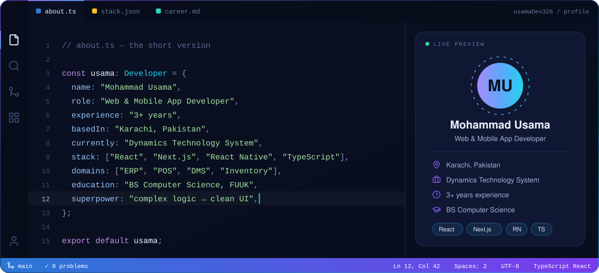

I'm a **Web & Mobile App Developer** with **3+ years of professional experience**, building production-ready applications with **React.js, Next.js and React Native**. I enjoy turning complex business requirements into **clean, intuitive and scalable software**, the kind a whole team can build on without it falling apart six months later.

<table>
<tr>
<td width="50%" valign="top">

**What I do**

- Modern web apps with **React.js & Next.js**
- Cross-platform mobile apps with **React Native**
- Responsive, user-friendly interfaces
- REST API & backend integration

</td>
<td width="50%" valign="top">

**How I work**

- Performance, scalability, maintainable code
- ERP, POS, DMS, Inventory & business systems
- Close collaboration with design & backend teams
- Code reviews & thoughtful architecture

</td>
</tr>
</table>


 



<table>
<tr>
<td align="center" width="25%"><b>Frontend</b>   </td>
<td align="center" width="25%"><b>Styling & UI kits</b>     </td>
<td align="center" width="25%"><b>State & data</b>       Hooks · REST APIs · Auth</td>
<td align="center" width="25%"><b>Tools, cloud & more</b>     Insomnia · Debugging · Code review</td>
</tr>
</table>

 


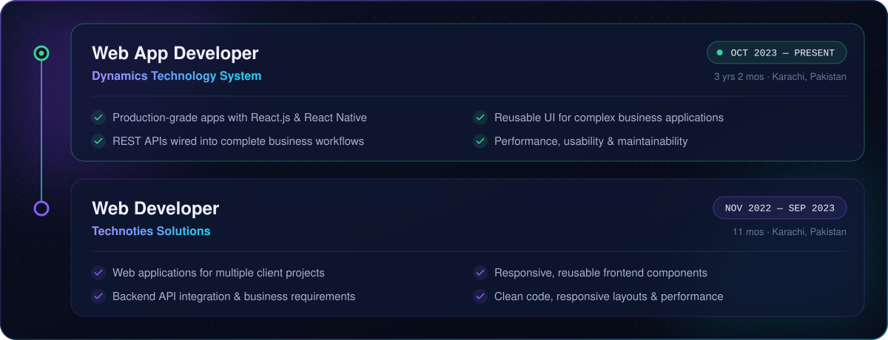

<b>Full responsibilities</b>

 

**Web App Developer · Dynamics Technology System** Oct 2023 — Present · Karachi

- Develop production-grade web applications using **React.js and React Native**.
- Build responsive and reusable UI components for complex business applications.
- Integrate REST APIs and implement complete business workflows.
- Collaborate with UI/UX designers and backend developers.
- Improve application performance, usability and maintainability.
- Participate in code reviews, feature planning and technical problem solving.

**Web Developer · Technoties Solutions** Nov 2022 — Sep 2023 · Karachi

- Developed web applications for multiple client projects.
- Built responsive and reusable frontend components.
- Integrated backend APIs and implemented business requirements.
- Collaborated with designers and backend developers.
- Focused on clean code, responsive layouts and application performance.

 


  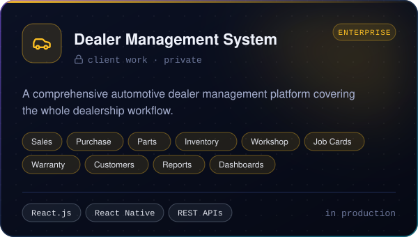
  <a href="https://github.com/usamaDev326/dtsPOS">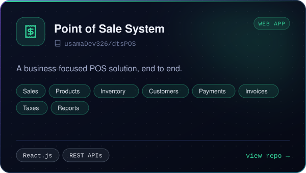</a>

  <a href="https://github.com/usamaDev326/aquaPure">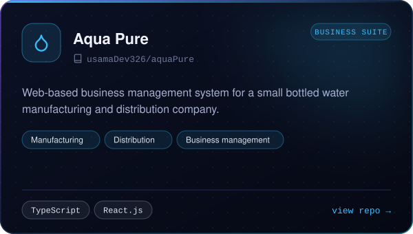</a>
  <a href="https://github.com/usamaDev326/U-Dev-Dashboard-React">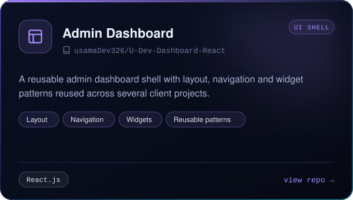</a>

  <a href="https://github.com/usamaDev326/KWTRO_Dts">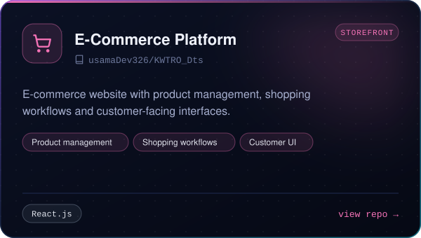</a>
  <a href="https://github.com/usamaDev326/DTS-Website">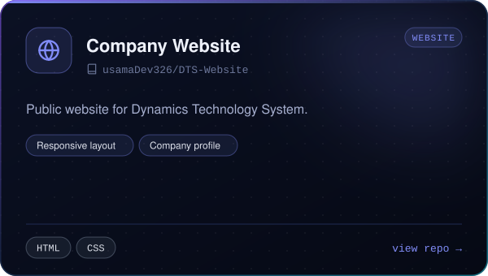</a>

  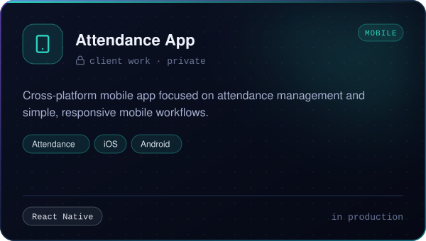
  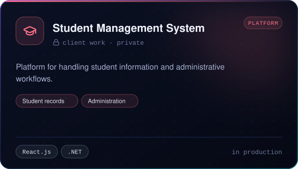

  <a href="https://github.com/usamaDev326/artifacts">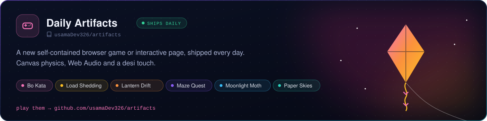</a>

  

 



I particularly enjoy **complex business applications** where multiple modules, workflows, permissions and API integrations need to work together as one consistent system.

 




<picture>
  <source media="(prefers-color-scheme: dark)" srcset="./assets/generated/snake-dark.svg" />
  <source media="(prefers-color-scheme: light)" srcset="./assets/generated/snake-light.svg" />
  
</picture>

 


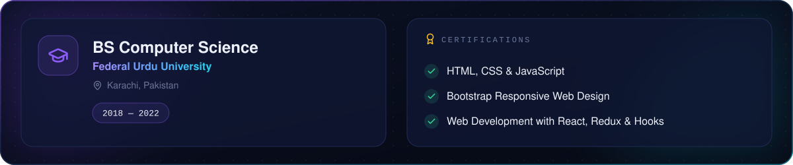

 


Improving application architecture, performance and reusable component systems, and building better solutions for complex business workflows.

 


Always happy to talk about

<kbd>Interesting software projects</kbd> <kbd>Product ideas</kbd> <kbd>React / Next.js</kbd> <kbd>React Native apps</kbd> <kbd>Business & ERP systems</kbd> <kbd>Collaboration</kbd>

  

 

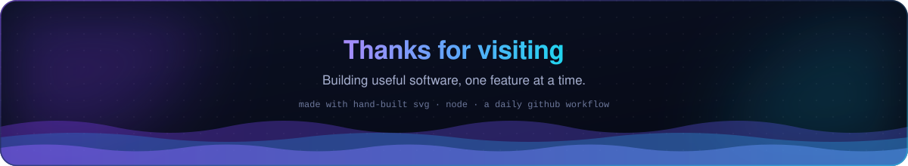
